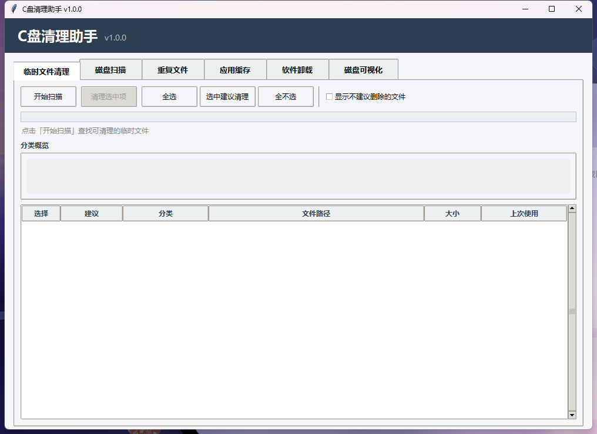

# C盘清理助手

一款为 Windows 打造的本地磁盘空间分析与清理工具。六大模块覆盖临时文件、重复文件、应用缓存、软件卸载和磁盘空间可视化，全程本地运行、不上传任何数据、删除前必须由用户确认。


## 界面预览



## 功能特性

| 模块 | 能力 | 关键设计 |
| --- | --- | --- |
| 临时文件清理 | 扫描用户 TEMP、Windows Temp、Prefetch、浏览器缓存 | 分类概览条、按文件类型给出「建议清理 / 可酌情清理 / 不建议删除」三级建议，危险项默认隐藏 |
| 磁盘扫描 | 全盘扫描或指定目录，按大小排序展示大文件 | 可调阈值、实时进度（耗时 / 文件数）、双击定位文件 |
| 重复文件 | 两阶段检测：先按大小分组，再计算 MD5 | 同组内自动标记「保留一份」，支持批量移入回收站 |
| 应用缓存 | 自动检测微信、QQ、钉钉、QQ 浏览器并统计缓存占用 | 无需手动配置路径，清理后自动复扫刷新数值 |
| 软件卸载 | 从注册表枚举已安装软件（HKLM / HKCU，32 / 64 位） | 识别超过半年未使用的软件；`InstallLocation` 为空时从 `DisplayIcon` / `UninstallString` 反推安装目录；调用软件自带卸载程序 |
| 磁盘可视化 | Squarified Treemap 树状图展示空间占用 | 点击方块逐层下钻，面包屑 / 右键返回；父节点缓存复用，返回耗时从秒级降至 ~2ms |

## 技术栈

- **语言 / GUI**：Python 3.10+、Tkinter + ttk
- **核心依赖**：标准库为主 —— `os`、`winreg`、`hashlib`、`threading`、`subprocess`、`dataclasses`
- **文件删除**：`send2trash`（移入回收站，可恢复）
- **打包**：PyInstaller（单文件 exe，约 9.4 MB）

## 快速开始

### 方式一：直接运行（推荐）

前往 [Releases](../../releases) 下载 `C盘清理助手.exe`，双击运行，无需安装 Python。

### 方式二：从源码运行

```bash
git clone git@github.com:haoyunlailai/C-.git
cd C-   # 仓库目录（本地可重命名为 C盘内存处理项目）
pip install -r requirements.txt
python main.py
```

环境要求：Windows 10/11、Python 3.10+。

### 自行打包

```bash
pip install pyinstaller
pyinstaller "C盘清理助手.spec" --clean --noconfirm
# 输出：dist/C盘清理助手.exe
```

## 使用说明

1. **临时文件清理**：点击「开始扫描」→ 勾选分类 → 「清理选中项」。不建议删除的文件默认隐藏，可通过顶部开关显示。
2. **磁盘扫描**：选择扫描范围与大小阈值 → 扫描 → 按需删除。
3. **重复文件**：选择目录与最小文件大小 → 扫描 → 每组默认勾选待删除副本 → 删除。
4. **应用缓存**：点击「扫描缓存」→ 按应用或分类勾选 → 「清理选中缓存」。
5. **软件卸载**：点击「扫描已安装软件」→ 勾选「仅显示超过半年未使用的软件」筛选 → 勾选目标 → 「卸载选中」，在弹出向导中完成卸载。
6. **磁盘可视化**：选择磁盘 → 「开始扫描」→ 点击方块下钻；面包屑、返回按钮或右键均可回到上层。

## 项目结构

```
├── main.py                      # 程序入口
├── config.py                    # 扫描路径、安全策略、应用缓存配置
├── requirements.txt
├── C盘清理助手.spec             # PyInstaller 打包配置
├── core/
│   ├── scanner.py               # 临时文件 / 大文件扫描
│   ├── cleaner.py               # 删除执行器（回收站优先）
│   ├── duplicate_scanner.py     # 重复文件两阶段检测
│   ├── app_cache_scanner.py     # 应用缓存扫描
│   ├── software_scanner.py      # 注册表软件枚举 + 未使用检测
│   ├── treemap_scanner.py       # Squarified Treemap 布局 + 目录扫描
│   └── utils.py
├── ui/
│   ├── main_window.py           # 主窗口与 6 个 Tab
│   ├── temp_clean_page.py
│   ├── disk_scan_page.py
│   ├── duplicate_page.py
│   ├── app_cache_page.py
│   ├── software_uninstall_page.py
│   └── treemap_page.py
└── docs/screenshots/
```

## 设计亮点

### 安全优先

- 扫描阶段只读，不修改任何文件；
- 删除前必须勾选并二次确认，默认移入回收站；
- 内置保护列表：跳过 `System32`、`WinSxS`、`Program Files` 等系统目录，以及 `.ssh`、`.aws`、`*.key`、`*.pem` 等敏感路径与文件；
- 应用缓存因可重新生成，使用 `os.remove` 直接删除（绕开 send2trash 在 8.3 短路径上的 WinError 161 问题）。

### 算法与实现

- **Squarified Treemap**：按面积递归切分矩形，尽量保持接近 1 的长宽比，避免细长条难以点击与阅读；
- **重复文件两阶段检测**：先按文件大小分组排除绝大多数候选，再仅对同大小文件计算 MD5，显著减少磁盘 I/O；
- **安装路径反推链**：注册表 `InstallLocation` → `DisplayIcon` → `UninstallString`，跳过 MSI 产品码与 `msiexec` 命令，将路径覆盖率从 39% 提升至 57%；
- **导航缓存**：下钻时保留父节点对象，返回与面包屑跳转直接复用内存中的扫描结果，无需重新遍历磁盘。

### 工程细节

- 所有耗时操作运行在后台线程，通过 `frame.after(0, callback)` 回到 UI 线程，界面不卡顿；
- 目录扫描限制深度与条目数（Treemap 每层 TOP 15 + 「其他」聚合），在信息量与性能间取平衡；
- 应用数据路径按真实安装位置探测（微信 / QQ 等数据目录常位于 D 盘等非默认路径）。

## 开发方式（Vibe Coding）

本项目采用「AI 结对开发」模式完成：需求拆解 → AI 生成实现 → 人工运行验证 → 用测试脚本复现问题 → 迭代修复。几个有代表性的调试案例：

| 问题 | 根因 | 修复 |
| --- | --- | --- |
| 重复文件第二次删除无反应 | `Treeview.delete()` 删除父节点会连带删除子节点，之后 `get_children()` 抛 `TclError` | 先收集子节点，再删除父节点 |
| 缓存清理后数值不变 | `send2trash` 对 8.3 短路径抛 `WinError 161`，所有删除静默失败 | 缓存改用 `os.remove`，清理后自动复扫 |
| Treemap 部分方块消失 | 布局循环中边遍历边 `pop()` 修改列表，导致元素被跳过 | 改为 `while row: pop(0)` 显式消费 |
| 返回上一层缓慢 | 每次返回都重新扫描目录 | 缓存父节点，命中缓存时直接渲染（~2ms） |

## 已知限制

- 仅支持 Windows（依赖注册表、资源管理器等系统能力）；
- 「超过半年未使用」基于安装目录内文件的最新修改时间推断，若软件长期只读运行可能产生误判；
- 部分 MSI 安装的软件无安装位置信息，无法反推路径；
- 应用缓存目前覆盖微信、QQ、钉钉、QQ 浏览器四款。

## 开源许可

[MIT License](LICENSE)
